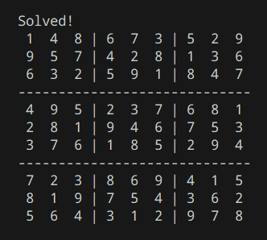

# SkyDiary

A terminal-based Sudoku solver, built using recursive backgracking.
It takes an unsolved sudoku, and uses backtracking to explore possible values and find a solution.

## Screenshots

<details>
<summary>🖥️ Bekijk Desktop Screenshots</summary>

### Demo


</details>

## Features

Solve Sudoku puzzles automatically.

Uses recursive backtracking to explore possible solutions.

Checks whether a number can be placed in a particular position.

Backtracks when a chosen number leads to an invalid solution.

Displays the solved puzzle in the terminal.

## Built With

Python

## Algorithm

#### The solver uses recursive backtracking:

Find an empty cell in the Sudoku grid.

Try possible numbers from 1 to 9.

Check whether a number is valid according to Sudoku rules.

If valid, place the number and recursively solve the remaining puzzle.

If the choice leads to a dead end, remove the number and try another possibility.

Continue until the puzzle is solved or no solution can be found.

## What I Learned

Implementing recursive algorithms.

Understanding and applying backtracking by understanding how algorithms explore possible solutions.

Breaking down complex problems into smaller steps.

## Getting Started

#### Prerequisites
- Node.js
- npm

#### Installation

1. Clone the repository:
   ```bash
   git clone https://github.com
   ```
2. Navigate to the project's folder.
3. Run the application.

## Development

Independently developed as an exercise in algorithmic problem-solving and recursive programming.